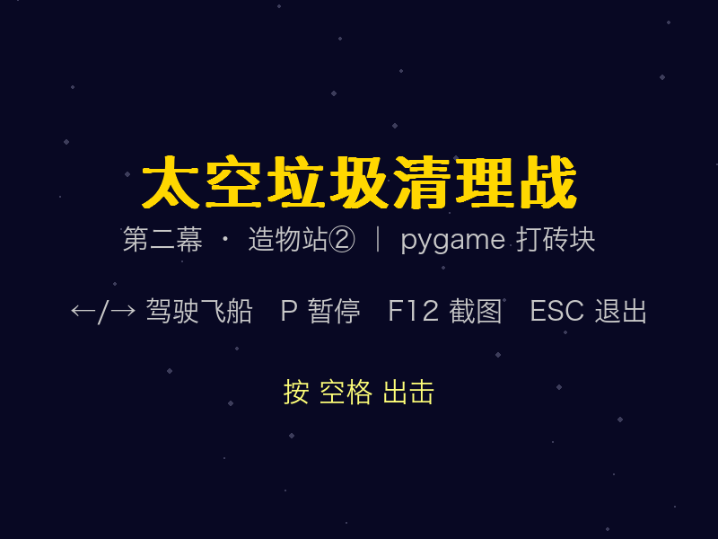
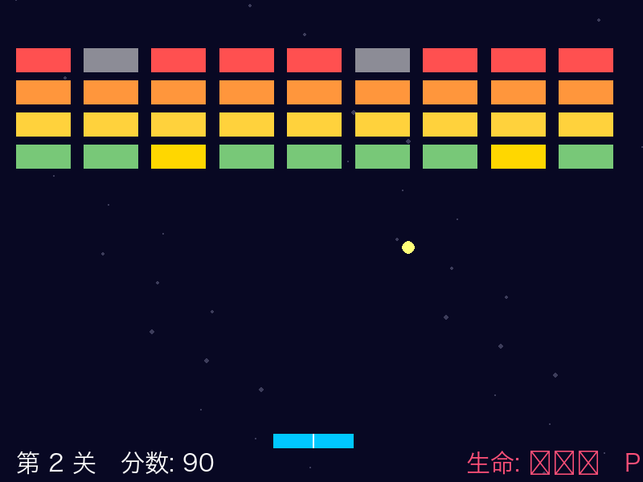

# 太空垃圾清理战（Python pygame 打砖块）

> 第二幕 · 造物站 ② ｜ 机制：pygame 打砖块 = 轨道实战 ｜ 5 课时 × 90 分钟
> 课纲关键词：**Python · pygame · 游戏开发 · 打砖块 · 碰撞检测 · 事件驱动**




## 故事

航线练成了，码力造出清理飞船冲上轨道。漂浮的太空垃圾挡住了阳光、砸坏了充电卫星——驾驶飞船，用能量球把它们一块块击碎！

轨道疏通的那天，阳光重新照回了地面。

> 想直接玩成品？运行 [太空垃圾清理战-展示版.py](./太空垃圾清理战-展示版.py)（3 关、控球、硬垃圾、暂停、通关结算）。操作：←/→ 驾驶，空格 开始，P 暂停，F12 截图。

## 我会学到什么

| 课时 | 我做出什么 | 新超能力 |
| --- | --- | --- |
| 1 · 造一扇舷窗 | 深夜色的游戏窗口 + 星野 + 流星雨 | pygame 窗口、游戏主循环（听-算-画-等）、帧率与动画 |
| 2 · 驾驶飞船 | 用方向键开动的飞船（含边界护栏） | 键盘控制 get_pressed、事件驱动 KEYDOWN、Rect 角色身份证 |
| 3 · 发射能量球 | 会撞墙、撞飞船反弹的能量球（还能控球角度） | 速度向量、边界反弹、碰撞检测 colliderect、角度反弹 |
| 4 · 垃圾矩阵 | 击碎垃圾砖阵 + 实时计分板 | 嵌套循环铺砖、列表管理角色、碰撞消除、字体渲染 |
| 5 · 轨道疏通 | **毕业作品：完整可玩的多关卡游戏** | 生命与游戏状态、胜负画面、关卡数据驱动 |

核心心法一句话：**游戏主循环 = 听 → 算 → 画 → 等**（听事件、算位置、画画面、等下一帧），五节课都在往这四步里填东西。

## 准备环境（10 分钟）

1. 安装 [Thonny](https://thonny.org/)（推荐，自带 Python）
2. 安装 pygame：Thonny 菜单 **工具 → 管理软件包**，搜索 `pygame-ce` → 安装
   （命令行等价写法：`pip install pygame-ce`；代码里仍写 `import pygame`，两者通用）
3. 新建文件输入下面两行，运行弹出一个深色窗口就说明环境 OK：

```python
import pygame
pygame.init()
```

> ⚠️ 注意安装的是 `pygame-ce`（社区延续版，新 Python 有预编译包）；`import pygame` 的写法不变。Windows / macOS 都适用。

## 跟着做

> 每个步骤一个文件，卡住就对照文件里的注释。

### 第 1 课 · 造一扇舷窗（lesson1_造一扇舷窗/）

1. **step1 点亮舷窗**：最小 pygame 程序——init 点火、开窗、主循环、QUIT 退出
2. **step2 第一颗星**：fill 刷底 + circle 画星，游戏画面是每帧重画出来的
3. **step3 心脏起搏器**：clock.tick(60) + 每帧挪一步——动画的秘密（注释掉 fill 看拖尾！）
4. **step4 满天星野**：列表装 60 颗星，列表管角色从这课贯穿到毕业
5. **challenge 流星雨**：每颗流星自己的位置和速度，划落重生

### 第 2 课 · 驾驶飞船（lesson2_驾驶飞船/）

1. **step1 造飞船**：Rect = 角色的身份证（位置 + 大小一卡通）
2. **step2 飞船听令**：get_pressed 每帧问键盘——按住就动
3. **step3 别撞墙**：边界护栏（右护栏要减掉船自己的宽度）
4. **step4 飞船日志**：KEYDOWN 事件 = 门铃，按一下响一声（换涂装）；持续动作用点名、单次动作用门铃
5. **challenge 我的驾驶舱**：四方向飞行 + 三角形飞船 polygon

### 第 3 课 · 发射能量球（lesson3_发射能量球/）

1. **step1 发射**：速度 = 每帧挪多少（y 轴向下为正，负数向上飞）
2. **step2 撞墙反弹**：撞哪面墙就把那个方向的速度反过来
3. **step3 飞船反弹**：colliderect 身份证碰身份证 + 防粘连
4. **step4 角度反弹**：打飞船左边缘球往左飞——你是控球手
5. **challenge 双球齐发**：列表管理多颗球，各飞各的

### 第 4 课 · 垃圾矩阵（lesson4_垃圾矩阵/）

1. **step1 垃圾漂浮**：一行垃圾块（算式 20 + i * 96 是怎么来的）
2. **step2 垃圾矩阵**：循环套循环铺 4×8 砖阵，颜色按行分
3. **step3 击碎垃圾**：碰撞 → 从名单删除 → 反弹加分（先复印名单再删的大坑）
4. **step4 分数面板**：pygame.font 把字画进游戏，f"分数: {score}" 会说话的字符串
5. **challenge 特殊垃圾**：硬垃圾（2 条命、挨打变色）+ 金垃圾（50 分）

### 第 5 课 · 轨道疏通（lesson5_轨道疏通/）

1. **step1 三条命**：漏球扣命、Game Over 画面、空格重开
2. **step2 胜利之光**：清空垃圾 → 晨光金胜利画面（"阳光重回地面"）
3. **step3 关卡数据**：LEVELS 关卡表——改关卡不碰逻辑，数据驱动设计
4. **step4 毕业作品**：《太空垃圾清理战》五课总装，完整可玩
5. **challenge 关卡设计师**：字符地图设计关卡（G 普通 / H 硬 / J 金 / . 空）

## 挑战任务

- ⭐ 给飞船和能量球换你调的 RGB 配色
- ⭐⭐ 硬垃圾 + 金垃圾混编阵型（第 4 课 challenge）
- ⭐⭐⭐ 字符地图关卡设计师（第 5 课 challenge）
- 🏆 终极：给你的关卡设计"会移动的垃圾"（每帧挪一步 + 撞墙反向）
- 🤖 未来彩蛋：第三幕「码力创作工坊」学到的 AI，会反过来给这艘飞船**生成新关卡**——你现在打的地基，将来 AI 来盖楼

## 下一站预告

轨道疏通、阳光重回地面。但空荡荡的大地上，码力面对一个新的问题：旧世界清空了，拿什么填满？——下一站第三幕：AI 大脑「艾芯」登场，《会聊天的码力》。
